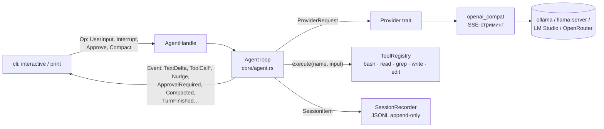

# Архитектура mark2

Дизайн собран из ресёрча существующих харнесов (codex-rs, goose, pi, aider, opencode, mini-swe-agent) — взяты работающие паттерны, отброшена продуктовая сложность. Полный план с обоснованиями: `docs/plans/completed/20260824-rust-agent-harness.md`.

## Главная идея

Модель — стохастическое ядро; харнесс — детерминированная обвязка, превращающая вероятностный вывод в контрактный результат. Всё, что можно сделать чистой функцией — сделано чистой функцией. Ядро не знает про UI.

## Поток данных (SQ/EQ)

Единственная абстракция, на которой держится всё: в ядро входят **`Op`** (submissions), наружу идёт плоский стрим **`Event`**. CLI — первый потребитель; TUI, ACP-адаптер, сервер — будущие потребители того же канала без изменений ядра.

## Крейты и модули

| Путь | Что делает |
|---|---|
| `crates/core` | Ядро-библиотека, ноль знаний о UI; HTTP — только у сетевых тулов (`reqwest`), провайдеры живут в `crates/providers` |
| — `message.rs` | Нейтральный формат: `Message`, `ContentBlock` (Text/Thinking/ToolUse/ToolResult), `MessageMetadata` (флаги видимости `agent_visible`/`user_visible`), `Usage` |
| — `event.rs` | `Event` и `Op` — serde-tagged, snake_case, стабильные wire-имена |
| — `provider.rs` | `trait Provider` (один обязательный метод `stream()`), `ProviderRequest`, `StreamChunk`, `ToolDef`, `ProviderError` (в т.ч. `ContextLengthExceeded` — на нём висит компакция) |
| — `agent.rs` | Цикл: `Agent::spawn() → (AgentHandle, Receiver<Event>)`; сэмплинг → тул-коллы → результаты → повтор; permission-гейт, отмена, интеграция компакции и сессий |
| — `tools/` | `trait Tool` + `ToolRegistry` (schemars-схемы, приведение типов аргументов к схеме — `coerce.rs`, jsonschema-валидация, retry-with-error); bash/read/grep/write/edit (`grep` — read-only поиск внутри cwd с капами); `confine.rs` — замок путей внутри cwd: `read`/`grep` канонизируют путь целиком, `write`/`edit` — покомпонентно (цель может не существовать; висячий симлинк и путь снаружи — отказ «outside the working directory», пишется резолвленный путь); `bash.rs::run_shell` — общий запуск `bash` и post-edit проверки, окружение детей без секретов (`scrub_env`, `SECRET_ENV_PATTERNS`); сетевые `web_fetch` (HTML → текст, `html.rs`) и `web_search` (SearXNG, только при заданном адресе) — общее в `web.rs`: капы, маркеры недоверенных данных |
| — `permission.rs` | `PermissionPolicy`: Yolo / AskWrites / ReadOnly; allowlist `READ_ONLY_TOOLS` (`read`/`grep`) — всё остальное за гейтом, включая мутирующие (`bash`/`edit`/`write`), сетевые (`web_fetch`/`web_search`) и неклассифицированные тулы |
| — `prompt.rs` | Системный промпт (≤1000 токенов вместе со схемами локальных тулов, сетевые — надбавка ≤175) + поиск AGENTS.md вверх от cwd (ближайший выигрывает) + секция `## Memory` последней, если есть память |
| — `memory.rs` | Память агента: поиск `.mark2.memory.md` (или `[agent] memory_file`), кап 4096 байт с обрезкой по строке, путь для модели |
| — `compact.rs` | Компакция: оценка токенов, суммаризация через провайдера, скрытие истории флагами |
| — `session.rs` | `SessionRecorder`/`load_session`: JSONL, фоновый писатель, толерантная загрузка |
| — `config.rs` | Слоёный TOML-конфиг: user → project → CLI; проектный слой только ужесточает (`validate_as_project`: без провайдера, `yolo`, `post_edit_command`, памяти вне своей директории; `merge_project`: policy — только строже); per-model настройки; `[web] search_base_url` с env-оверрайдом `MARK2_SEARXNG_URL`; `find_upwards` — общий обход «ближайший файл от cwd вверх», не выше `$HOME` (вне него — только cwd) |
| `crates/providers` | HTTP-реализации. `openai_compat.rs` — wire-типы Chat Completions (толерантный serde), сборка стрим-дельт (текст, reasoning, тул-коллы по index), ретраи до стрима, маппинг переполнения контекста; `sse.rs` — байтовый поток → SSE-события; `json_repair.rs` — спасение обрезанного JSON |
| `crates/cli` | Бинарь `mark2`: `main.rs` (сборка из конфига), `render.rs` (чистая функция Event → строка; `approval_prompt` — ключевое поле тула целиком, остальное JSON до 500 символов, управляющие символы экранированы), `interactive.rs`, `print.rs` |

## Один ход агента

1. `Op::UserInput` → `Event::TurnStarted`; проактивная проверка компакции (порог 0.8 × `context_limit`) **до** добавления нового ввода.
2. Со второй итерации — та же проверка перед сборкой запроса: результаты прошлого раунда тулов уже в истории, сжатие не оставит висящих `tool_use`. Без неё порог не видели бы однократный `-p` (история на старте пуста) и ollama, которая на переполнение не отказывает, а молча режет начало промпта.
3. Сборка `ProviderRequest`: системный промпт (+ AGENTS.md проекта, + память агента — собраны один раз при `Agent::new`), история с фильтром `agent_visible`, схемы тулов в фиксированном порядке.
4. `provider.stream()` → трансляция дельт (`TextDelta`/`ThinkingDelta`) наружу → `Complete{message, usage}` в историю.
5. Если в ответе нет `ToolUse` — `TurnFinished{Completed}`. Иначе для каждого тул-колла по порядку: permission-гейт (`ApprovalRequired` → ждём `Op::Approve`; отказ = обычный tool result с `is_error`) → `registry.execute` (валидация схемой; ошибка валидации уходит модели текстом — retry-with-error) → результаты одним сообщением в историю → следующая итерация сэмплинга (п. 2).
6. Предохранители: `max_turns`; детектор зацикливания и сенсор write-churn (см. «Надёжность tool calls») — первый смотрит на вызов до исполнения и может его не пустить, второй после и только дописывает подсказку; `ProviderError::ContextLengthExceeded` → компакция → ровно один повтор (компакция в итерации одна: переполнение сразу после неё — `Error`); `Op::Interrupt` в любой точке → `TurnFinished{Cancelled}`, при этом каждому начатому `tool_use` дописывается парный `tool_result` (строгие серверы ломаются на «висящих» tool calls).

## Ключевые инварианты (не ломать)

1. **История append-only.** Сообщения никогда не переписываются и не удаляются — только дописываются или помечаются флагами видимости. На этом стоят KV-кэш, сессии и компакция.
2. **Байт-стабильная сериализация.** Одинаковый вход → байт-в-байт одинаковый JSON (fixed field order, `preserve_order`). Стабильный префикс промпта = живой KV-кэш llama-server / prompt cache облаков. Есть тесты на это.
3. **Провайдер «глупый».** Ему приносят готовый запрос — фильтрация видимости, политики, компакция происходят в агенте.
4. **Ядро без UI.** `core` не печатает и не спрашивает — только `Event` наружу и `Op` внутрь. Рендер — чистая функция в потребителе.
5. **Каждому `tool_use` — парный `tool_result`**, даже при отказе, прерывании и таймауте.
6. **Толерантный wire-парсинг.** OpenAI-compat — диалект, не стандарт: `#[serde(default)]` везде, незнакомые поля игнорируются, reasoning-каналы (`reasoning_content`/`reasoning`) поддержаны оба.
7. **Отмена — один примитив**: `CancellationToken` (корень → ход → тул-колл). Стрим провайдера при отмене бросается, тул — дожидается (bash должен успеть убить process group).

## Надёжность tool calls на слабых моделях

Слои: (1) нативный chat-template сервера (`--jinja` у llama-server); (2) jsonschema-валидация против schemars-схем → ошибка возвращается модели как tool result; до неё — приведение типов без потерь на верхнем уровне аргументов (`"60"`/`"60.0"`/`60.0` → `60` для integer, `"1.5"` для number, `"true"`/`"false"` для boolean; мусор, дробь для integer, строковые поля не трогаются): агент приводит `tool_use` ещё до истории, так что сессия, события и тул видят одни и те же аргументы; каждое приведение — `Event::ArgumentsCoerced{id, name, fields}`, CLI суммирует их в итоговой строке stderr (`tokens: … · coerced N`), выключатель для абляции — `arg_coercion = false` в `[agent]`; (3) json_repair для обрезанных аргументов; неспасаемые помечаются `__mark2_unparsed` и отсекаются валидацией; (4) детектор зацикливания в agent loop: N-й подряд идентичный тул-колл (имя + сериализованный `input`) не исполняется — модели уходит `is_error` «не повторяй, ответь текстом», на 2×N-м ход завершается `Error` (`loop_detection` в `[agent]`, дефолт 3, `0` — выкл); (5) сенсор write-churn там же — ловит «метание», которое детектор зацикливания не видит (вызовы не идентичны): N-я подряд успешная запись (`write`/`edit` в любой смеси) в один и тот же путь без единого исполненного `bash` между записями **исполняется**, но к её результату (он остаётся успешным) дописывается подсказка «запусти и прочитай реальную ошибку, прежде чем переписывать, или упрости подход», с 2×N-й — жёсткая «смени стратегию: файл меньше, проверок за раз меньше». Ход сенсор не останавливает никогда — переписать файл законно. Сброс — любой исполненный `bash` (с любым кодом выхода) или запись в другой путь; `read`, упавшие и не исполненные записи нейтральны (чтение — не проверка); путь сравнивается после резолва от cwd и лексической свёртки `.`/`..`, содержимое не сравнивается. Счётчик свой, с детектором зацикливания не пересекается: заблокированный им повтор не исполнялся и сенсору не виден (`write_churn` в `[agent]`: `true` — дефолт, порог 3; `false` — выкл для абляции в бенче; число — свой порог). Срабатывание обоих предохранителей видно наружу как `Event::Nudge{id, guard, message}` сразу за `ToolCallFinished` своего вызова; CLI печатает его в stderr строкой `[agent] loop_detection: …` / `[agent] write_churn: …` — и в `-p`, и в интерактиве. Грамматики (GBNF) и toolshim — фаза 2.

## Системный промпт и память

Промпт собирается один раз при `Agent::new` и дальше байт-стабилен (инвариант 2): база (кто мы, cwd, правила) → `# Project instructions` из ближайшего AGENTS.md → `## Memory`. Порядок — по частоте изменений: память правит сама модель, поэтому она последняя и не сдвигает префикс остального. Память — это файл `.mark2.memory.md`, найденный тем же обходом вверх от cwd, что и `.mark2.toml` (`config::find_upwards`, каждый по своему ближайшему), либо явный `[agent] memory_file` — относительный путь резолвится от директории конфиг-файла ещё при разборе (`Config::parse`), явный путь без файла на диске = памяти нет, к поиску он не откатывается. Секция — однострочная конвенция («попросили запомнить — обнови файл через write/edit, коротко, только факты»; путь от cwd, если файл внутри него, иначе абсолютный) плюс содержимое не длиннее 4096 байт: длиннее — обрезка по границе строки с пометкой `[memory truncated: N of M bytes shown]` и `Event::Warning` первым событием стрима; файл не правится. Включение = существование непустого файла: нет файла или он пуст — секции нет вовсе, даже строки о конвенции, промпт байт-в-байт прежний (проверено против бинаря до памяти). Новых тулов нет: модель пишет память обычными `write`/`edit`, правки по ходу сессии видит в своей истории, в промпт они попадут в следующей сессии. Компакция суммаризирует только историю — системный промпт и память её переживают. Путь и размер инъекции — в `meta.memory` шапки сессии.

## Компакция

Четыре триггера: проактивно по порогу — перед ходом (до нового ввода) и перед каждой следующей итерацией внутри хода (оценка > 0.8 × лимита; оценка = последний `Usage`, фолбэк — байты/4); реактивно (`ContextLengthExceeded` — и до стрима, и error-фреймом внутри); вручную (`Op::Compact`). Шторм-защита: после компакции порог молчит, пока провайдер не пришлёт свежий `Usage` (байтовая оценка саммари может остаться выше порога — тогда идём сэмплить, а не пересжимаем), и в одной итерации сжатие максимум одно. Механика: agent-visible история суммаризируется отдельным коротким промптом → старые сообщения получают `agent_visible=false` (для пользователя и сессии остаются), саммари входит user-сообщением с `user_visible=false`. Скрывается вся видимая история целиком, поэтому `tool_use` и его `tool_result` уходят в скрытые вместе. Наружу — `Event::Compacted{before, after}`, в сессию — `SessionItem::Compacted`, скрытые копии и саммари.

## Тестирование

- Юнит-тесты в модулях; агент тестируется через `MockProvider` со скриптованными очередями `StreamChunk` — проверяются точные последовательности `Event` и содержимое запросов к провайдеру.
- Парсер стрима — на inline-фикстурах реальных SSE-чанков (OpenAI, llama-server, ollama, OpenRouter), собранных из живых форматов.
- e2e (`crates/cli/tests/e2e_local.rs`, `#[ignore]`) — против живого локального сервера: `cargo test -p mark2-cli --test e2e_local -- --ignored` (env: `MARK2_E2E_BASE_URL`, `MARK2_E2E_MODEL`).
- Бенчмарк моделей — `bench/STRATEGY.md`.

## Чего нет сознательно

MCP, субагенты, песочница, TUI — по фазам (см. роадмап в README). Память — только файл, который модель правит сама: ни векторных хранилищ, ни авто-записи в неё харнессом. Урок ресёрча: codex вырос до ~130 крейтов и turn.rs на 2800 строк, goose — до agent.rs на 6000 строк. Ядро mark2 остаётся маленьким; всё новое подключается как потребитель Op/Event, а не врастает в цикл.
